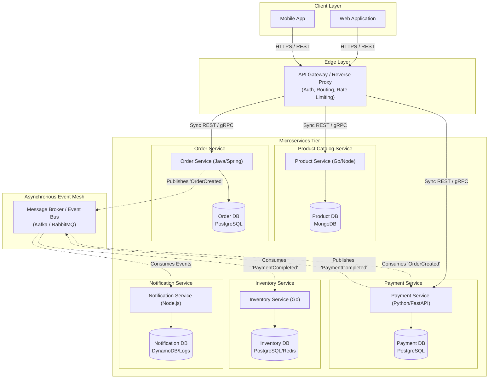

# Hands-On Exercise 1 (HON1): Monolith to Microservices Redesign

## 1. Review of the Monolithic E-Commerce Application

### Overview
In the initial monolithic design, all core e-commerce functionalities—**Product Catalog**, **Order Management**, **Payment Processing**, **Inventory**, **User Authentication**, and **Notifications**—reside within a single deployable unit (a single codebase) sharing a single centralized relational database.

```
+-----------------------------------------------------------------------+
|                    MONOLITHIC E-COMMERCE APPLICATION                  |
|                                                                       |
|  [ Auth Module ]  [ Product Module ]  [ Order Module ]                |
|  [ Payment Module ]  [ Inventory Module ]  [ Notification Module ]    |
+-----------------------------------------------------------------------+
                                  |
                                  v
                  +-------------------------------+
                  |  Shared Monolithic Database   |
                  +-------------------------------+
```

### Key Limitations & Pain Points
- **Single Point of Failure:** An unhandled error or memory leak in the payment or reporting logic can bring down the entire storefront.
- **Scalability Bottlenecks:** The entire application must be scaled out together, even if only the product browsing module experiences peak holiday traffic.
- **Tight Coupling & Slow Releases:** A small bug fix in notifications requires rebuilding, regression testing, and redeploying the entire system.
- **Technology Lock-In:** Developers are restricted to a single technology stack and cannot easily adopt specialized datastores or languages.

---

## 2. Microservice Decomposition & Responsibilities

Using Domain-Driven Design (DDD) principles and bounded contexts, the monolithic application is decoupled into autonomous services, each following the **Database-per-Service** pattern:

| Microservice | Primary Responsibilities | Data Store | Communication |
| :--- | :--- | :--- | :--- |
| **API Gateway** | Entry point, reverse proxy, SSL termination, request routing, authentication verification, and rate limiting. | Redis (Rate limiting/Cache) | Sync (HTTP/REST, gRPC) |
| **Product / Catalog Service** | Manages product listings, categories, search, pricing, and metadata. | Document DB (e.g., MongoDB / Elasticsearch) | Sync (gRPC/REST) for queries |
| **Order Service** | Manages shopping carts, order creation, order state machine, and order history. | Relational DB (e.g., PostgreSQL) | Sync (REST/gRPC), Async (Kafka/RabbitMQ events) |
| **Payment Service** | Integrates with third-party gateways (Stripe/PayPal), processes charges, and tracks transaction statuses. | ACID Relational DB (e.g., PostgreSQL) | Async Event-driven (Pub/Sub) + Sync webhook |
| **Inventory Service** | Manages stock availability, reservations during checkout, and warehouse restocking. | Relational/In-Memory DB (PostgreSQL / Redis) | Async Event-driven subscriber |
| **Notification Service** | Sends transactional emails, SMS, and push notifications for order confirmations and shipping updates. | NoSQL / Log store | Async Event-driven subscriber |

---

## 3. Microservices Architecture Diagram

### Communication Flows
1. **Synchronous Flow (Client to Services via API Gateway):** External clients communicate via HTTPS REST/gRPC with the API Gateway, which routes requests to the relevant microservices.
2. **Asynchronous Flow (Event-Driven Inter-Service Communication):** When an order is placed, the **Order Service** publishes an `OrderCreated` event to the **Message Broker (Kafka/RabbitMQ)**.
3. The **Payment Service** consumes the event, completes the charge, and emits `PaymentSucceeded` or `PaymentFailed`.
4. The **Inventory Service** adjusts available quantities, while the **Notification Service** dispatches confirmation messages independently.



### Visual ASCII Architectural Layout
```
[ Web / Mobile Clients ]
           | (HTTPS / REST)
           v
+-------------------------------------------------------------+
|              API GATEWAY & LOAD BALANCER                    |
|   (Authentication, Rate Limiting, Request Routing)          |
+-------------------------------------------------------------+
       |                         |                     |
 (Sync REST/gRPC)         (Sync REST/gRPC)      (Sync REST/gRPC)
       v                         v                     v
+----------------+       +----------------+    +----------------+
| Product Svc    |       | Order Svc      |    | Payment Svc    |
| [(Product DB)] |       | [(Order DB)]   |    | [(Payment DB)] |
+----------------+       +----------------+    +----------------+
                                 |                     ^
                     publishes   |                     | consumes
                     events      v                     | events
                 +-----------------------------------------+
                 |   EVENT BUS / MESSAGE BROKER (Kafka)   |
                 +-----------------------------------------+
                                 |                     |
                      consumes   |                     | consumes
                      events     v                     v events
                         +----------------+    +----------------+
                         | Inventory Svc  |    | Notif Svc      |
                         | [(Inv DB)]     |    | [(Notif DB)]   |
                         +----------------+    +----------------+
```

---

## 4. Advantages of the New Architecture

1. **Targeted Elastic Scalability:** High-demand components (such as catalog searching during flash sales) can scale horizontally in containers without allocating resources to payment or order modules.
2. **Fault Isolation & Resilience:** A temporary crash or latency spike in the third-party payment gateway or notification worker does not disrupt customers' ability to browse products or inspect items.
3. **Autonomous Delivery & Rapid CI/CD:** Engineering teams own independent codebases and deployment lifecycles, enabling multiple low-risk deployments per day.
4. **Polyglot Persistence & Tooling:** Each service leverages the database best suited to its domain (e.g., Elasticsearch/MongoDB for catalog searches, PostgreSQL for transactional order records).
5. **Decoupled Asynchronous Processing:** Event-driven architecture ensures that intensive tasks (payment reconciliation, email generation, inventory tracking) run without blocking the customer's checkout thread.

---

## Deliverable

### Architecture Diagram
*(Refer to Section 3 above for the full architectural diagram and interaction flow.)*

### Why Microservices Are a Better Fit for Cloud-Native Development
> **Brief Explanation (Word count: 117 words):**  
> Microservices align directly with cloud-native principles by breaking down monolithic dependencies into modular, containerized workloads optimized for orchestration via Kubernetes and serverless platforms. In cloud environments, traffic fluctuates dynamically; a microservices model allows granular, policy-based autoscaling of individual high-traffic services—such as product browsing—without provisioning expensive compute for the entire application. Furthermore, cloud-native deployments demand resilience and continuous delivery. Microservices decouple failure domains so that an outage in payment or notification services never halts storefront availability. Through managed cloud services, automated CI/CD pipelines, and declarative infrastructure, distributed teams can independently build, test, and release microservices continuously. Combined with polyglot cloud databases and managed event streaming, microservices fully harness elastic cloud scalability, operational agility, self-healing architectures, and cost efficiency.
