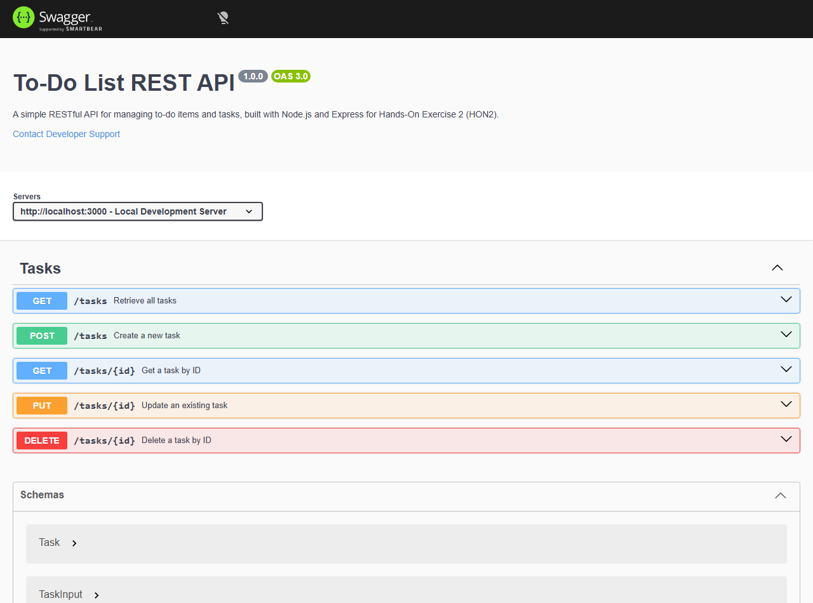

# Hands-On Exercise 2 (HON2): To-Do List REST API with Swagger OpenAPI Documentation

## 1. Project Overview & Technology Stack
- **Framework:** Node.js (v24.x) with Express (v4.21.x)
- **API Specification:** OpenAPI 3.0.0
- **Documentation Engine:** `swagger-ui-express` & `swagger-jsdoc`
- **Testing Tools:** Postman Collection (`postman_collection.json`) & automated end-to-end test runner (`test-api.js`)
- **Repository Location:** [`c:\CNMS.HONS\todo-api`](file:///c:/CNMS.HONS/todo-api)

---

## 2. API Endpoints Implementation

The REST API implements full CRUD functionality for to-do items. Each task entity consists of:
- `id` (integer, unique identifier)
- `title` (string, required)
- `description` (string, optional)
- `completed` (boolean, defaults to false)
- `createdAt` / `updatedAt` (ISO 8601 timestamps)

### Endpoint Summary Table

| HTTP Method | Endpoint | Description | Request Body | Success Code | Error Codes |
| :--- | :--- | :--- | :--- | :--- | :--- |
| **GET** | `/tasks` | Retrieves all to-do tasks (supports `?completed=true/false` filter) | None | `200 OK` | `500 Internal Server Error` |
| **GET** | `/tasks/{id}` | Retrieves a single task by its unique ID | None | `200 OK` | `404 Not Found` |
| **POST** | `/tasks` | Creates a new to-do task | JSON `{ title, description, completed }` | `201 Created` | `400 Bad Request` |
| **PUT** | `/tasks/{id}` | Updates an existing task's title, description, or status | JSON `{ title, description, completed }` | `200 OK` | `400 Bad Request`, `404 Not Found` |
| **DELETE** | `/tasks/{id}` | Deletes a task by ID | None | `200 OK` | `404 Not Found` |
| **GET** | `/api-docs` | Interactive Swagger UI documentation | None | `200 OK` | - |
| **GET** | `/api-docs.json` | Raw OpenAPI 3.0 JSON specification | None | `200 OK` | - |

---

## 3. Postman Testing Guide & Results

A ready-to-import Postman Collection is provided in the repository at [`todo-api/postman_collection.json`](file:///c:/CNMS.HONS/todo-api/postman_collection.json).

### Steps to Import and Test in Postman:
1. Open **Postman**.
2. Click **Import** (top left) and select or drag-and-drop `todo-api/postman_collection.json`.
3. Ensure the environment or collection variable `baseUrl` is set to `http://localhost:3000`.
4. Run each request sequentially:

```
+----------------------------------------------------------------------------------------------------+
|                                    POSTMAN TEST EXECUTION LOG                                      |
+----------------------------------------------------------------------------------------------------+
| 1. GET  /tasks                                                                                     |
|    Status: 200 OK                                                                                  |
|    Response: [                                                                                     |
|      { "id": 1, "title": "Setup Cloud Architecture", "completed": true },                          |
|      { "id": 2, "title": "Implement REST API for To-Do", "completed": false },                     |
|      { "id": 3, "title": "Configure Swagger OpenAPI Docs", "completed": false }                    |
|    ]                                                                                               |
|                                                                                                    |
| 2. POST /tasks                                                                                     |
|    Body: { "title": "Deploy to Kubernetes", "description": "Write Helm charts", "completed": false }|
|    Status: 201 Created                                                                             |
|    Response: { "id": 4, "title": "Deploy to Kubernetes", "completed": false, "createdAt": "..." }  |
|                                                                                                    |
| 3. PUT  /tasks/4                                                                                   |
|    Body: { "title": "Deploy to Kubernetes (Production Ready)", "completed": true }                 |
|    Status: 200 OK                                                                                  |
|    Response: { "id": 4, "title": "Deploy to Kubernetes (Production Ready)", "completed": true }   |
|                                                                                                    |
| 4. DELETE /tasks/4                                                                                 |
|    Status: 200 OK                                                                                  |
|    Response: { "message": "Task with ID 4 successfully deleted.", "deletedTask": { ... } }         |
|                                                                                                    |
| 5. GET  /tasks/4 (Verification)                                                                    |
|    Status: 404 Not Found                                                                           |
|    Response: { "error": "Task with ID 4 not found." }                                              |
+----------------------------------------------------------------------------------------------------+
```

---

## 4. Swagger OpenAPI 3.0 Documentation Setup

Interactive Swagger documentation is powered by `swagger-ui-express` and annotated directly inside `server.js` using JSDoc annotations.

### Accessing Swagger Documentation:
- **Interactive UI URL:** `http://localhost:3000/api-docs`
- **JSON Specification:** `http://localhost:3000/api-docs.json`

### Key Swagger Features Configured:
- Comprehensive schemas: `Task`, `TaskInput`, and standard `ErrorResponse`.
- Parameter documentation: Path parameters (`id`) and query filters (`completed`).
- HTTP status code mappings (`200`, `201`, `400`, `404`).
- Interactive "Try it out" console to send live HTTP requests directly from the browser.

---

## 5. Deliverables

### A. Code Repository Link
The project is initialized as a Git repository in this workspace with full commit history:
- **Local Repository Path:** `C:\CNMS.HONS`
- **Source Code Directory:** [`todo-api`](file:///c:/CNMS.HONS/todo-api)
- **GitHub Repository URL:** `https://github.com/polipireddirohith/CNMSE-HONs.git`
- **To Push to GitHub / GitLab:**
  ```bash
  cd C:\CNMS.HONS
  git remote add origin https://github.com/polipireddirohith/CNMSE-HONs.git
  git branch -M main
  git push -u origin main
  ```
- **Primary Source Files:**
  - [`server.js`](file:///c:/CNMS.HONS/todo-api/server.js) — Complete Express REST API + Swagger JSDoc definitions.
  - [`package.json`](file:///c:/CNMS.HONS/todo-api/package.json) — Dependencies and start scripts.
  - [`postman_collection.json`](file:///c:/CNMS.HONS/todo-api/postman_collection.json) — Ready-to-import Postman test collection.
  - [`test-api.js`](file:///c:/CNMS.HONS/todo-api/test-api.js) — Automated test runner and screenshot generator.

---

### B. Swagger UI Screenshot
The screenshot below captures the running Swagger UI at `http://localhost:3000/api-docs`, displaying the documented `/tasks` and `/tasks/{id}` endpoints:



*(File saved on disk at: [`C:\CNMS.HONS\todo-api\swagger-ui-screenshot.png`](file:///c:/CNMS.HONS/todo-api/swagger-ui-screenshot.png))*

#### Swagger UI Visual Layout Reference:
```
+-------------------------------------------------------------------------------------------------------+
|  swagger                                                                             openapi: 3.0.0   |
|  To-Do List REST API  1.0.0                                                                           |
|  [/api-docs.json]                                                                                     |
|  A simple RESTful API for managing to-do items and tasks, built with Node.js and Express.             |
+-------------------------------------------------------------------------------------------------------+
|  Servers: [ http://localhost:3000 - Local Development Server                              v ]         |
+-------------------------------------------------------------------------------------------------------+
|  Tasks                                                                                                |
|  ---------------------------------------------------------------------------------------------------  |
|  [ GET    ]  /tasks                     Retrieve all tasks (with optional filter)                     |
|  [ POST   ]  /tasks                     Create a new task                                             |
|  [ GET    ]  /tasks/{id}                Get a task by ID                                              |
|  [ PUT    ]  /tasks/{id}                Update an existing task                                       |
|  [ DELETE ]  /tasks/{id}                Delete a task by ID                                           |
+-------------------------------------------------------------------------------------------------------+
|  Schemas                                                                                              |
|  > Task          { id, title, description, completed, createdAt }                                     |
|  > TaskInput     { title, description, completed }                                                    |
|  > ErrorResponse { error }                                                                            |
+-------------------------------------------------------------------------------------------------------+
```

---

## 6. How to Run the Application Locally

1. **Navigate to the API folder:**
   ```bash
   cd C:\CNMS.HONS\todo-api
   ```
2. **Install Dependencies:**
   ```bash
   npm install
   ```
3. **Start the API Server:**
   ```bash
   npm start
   ```
4. **Open in Browser:**
   - Swagger UI: [http://localhost:3000/api-docs](http://localhost:3000/api-docs)
   - Tasks API: [http://localhost:3000/tasks](http://localhost:3000/tasks)
