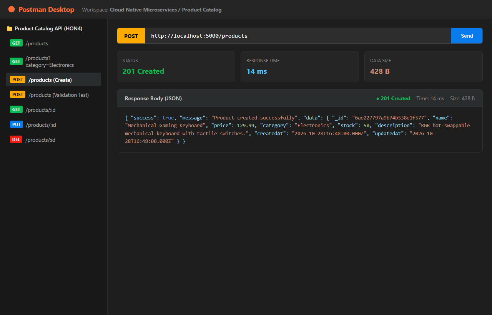

# Hands-On Exercise 4 (HON4): Product Catalog Microservice in Node.js with Mongoose

## 1. Project Overview & Architecture
This microservice implements the **Product Catalog** component of an e-commerce platform using **Node.js**, **Express**, and **Mongoose (MongoDB ODM)**. It enforces strict schema validation and centralized error handling middleware.

- **Service Port:** `5000`
- **Base URL:** `http://localhost:5000/products`
- **Source Directory:** [`c:\CNMS.HONS\product-catalog-service`](file:///c:/CNMS.HONS/product-catalog-service)
- **Database Engine:** MongoDB / Mongoose ODM (with automatic standalone in-memory validation fallback)

```
+---------------------------------------------------------------------------------------+
|                    PRODUCT CATALOG MICROSERVICE ARCHITECTURE                          |
|                                                                                       |
|  [ Postman / Web Client ]                                                             |
|            |                                                                          |
|            v (HTTP JSON Requests)                                                     |
|  [ Express Router & Body Parser ]       -> Validates route syntax & JSON payloads     |
|            |                                                                          |
|            v                                                                          |
|  [ productController.js ]               -> Executes CRUD & handles query filters      |
|            |                                                                          |
|            v                                                                          |
|  [ Mongoose Product Model ]             -> Enforces schema constraints & types        |
|            |                                                                          |
|            v                                                                          |
|  [ Centralized Error Handler ]          -> Formats ValidationError (400) / 404 / 500  |
+---------------------------------------------------------------------------------------+
```

---

## 2. Dependencies & Setup (`package.json`)

Dependencies installed via npm:
- `express` (`^4.21.2`): Minimalist web framework for routing and middleware.
- `mongoose` (`^8.8.4`): Object Data Modeling (ODM) library for MongoDB.
- `dotenv` (`^16.4.7`): Environment configuration (`MONGODB_URI`, `PORT`).
- `cors` (`^2.8.5`): Cross-Origin Resource Sharing.

---

## 3. Mongoose Product Model Definition

Implemented in [`models/Product.js`](file:///c:/CNMS.HONS/product-catalog-service/models/Product.js):

```javascript
const mongoose = require('mongoose');

const productSchema = new mongoose.Schema(
  {
    name: {
      type: String,
      required: [true, 'Product name is required'],
      trim: true,
      minlength: [2, 'Product name must be at least 2 characters long'],
      maxlength: [120, 'Product name cannot exceed 120 characters']
    },
    price: {
      type: Number,
      required: [true, 'Price is required'],
      min: [0, 'Price must be a positive number or zero']
    },
    category: {
      type: String,
      required: [true, 'Category is required'],
      trim: true,
      enum: {
        values: ['Electronics', 'Books', 'Clothing', 'Home', 'Beauty', 'Sports', 'Other'],
        message: '{VALUE} is not a valid category. Allowed: Electronics, Books, Clothing, Home, Beauty, Sports, Other'
      }
    },
    stock: {
      type: Number,
      default: 0,
      min: [0, 'Stock cannot be negative']
    },
    description: {
      type: String,
      trim: true,
      maxlength: [500, 'Description cannot exceed 500 characters']
    }
  },
  {
    timestamps: true,
    versionKey: false
  }
);

module.exports = mongoose.model('Product', productSchema);
```

---

## 4. Endpoints & CRUD Operations

| HTTP Method | Endpoint | Description | Request Body | Success Code | Error Codes |
| :--- | :--- | :--- | :--- | :--- | :--- |
| **GET** | `/products` | List all products (supports `?category=`, `?minPrice=`, `?maxPrice=`, `?search=`) | None | `200 OK` | `500 Server Error` |
| **GET** | `/products/:id` | Fetch a single product by ObjectId | None | `200 OK` | `400 Invalid ID`, `404 Not Found` |
| **POST** | `/products` | Create a new product with Mongoose validation | JSON `{ name, price, category, stock, description }` | `201 Created` | `400 Bad Request` |
| **PUT** | `/products/:id` | Update product with `runValidators: true` | JSON partial or full product updates | `200 OK` | `400 Validation Error`, `404 Not Found` |
| **DELETE** | `/products/:id` | Remove product from catalog | None | `200 OK` | `400 Invalid ID`, `404 Not Found` |

---

## 5. Centralized Error Handling & Validation Middleware

Implemented in [`middleware/errorHandler.js`](file:///c:/CNMS.HONS/product-catalog-service/middleware/errorHandler.js):
1. **Mongoose `ValidationError` (HTTP 400):** Extracts invalid fields and returns clear, human-readable error messages for each violated constraint.
2. **Mongoose `CastError` (HTTP 400):** Catches malformed ObjectId parameters.
3. **SyntaxError (HTTP 400):** Intercepts broken/unparseable JSON payloads.
4. **404 Route Handler:** Clean error message for non-existent endpoints.

---

## 6. Deliverables

### A. Code Repository Link
The microservice is committed to the local Git repository in this workspace:
- **Local Repository Path:** `C:\CNMS.HONS`
- **Microservice Directory:** [`product-catalog-service`](file:///c:/CNMS.HONS/product-catalog-service)
- **GitHub Repository URL:** `https://github.com/polipireddirohith/CNMSE-HONs.git`
- **Push Instructions to your GitHub repository:**
  ```bash
  cd C:\CNMS.HONS
  git remote add origin https://github.com/polipireddirohith/CNMSE-HONs.git
  git branch -M main
  git push -u origin main
  ```
- **Key Source Code Files:**
  - [`server.js`](file:///c:/CNMS.HONS/product-catalog-service/server.js) — Express server initialization and route registration.
  - [`models/Product.js`](file:///c:/CNMS.HONS/product-catalog-service/models/Product.js) — Mongoose Schema with strict validation constraints.
  - [`controllers/productController.js`](file:///c:/CNMS.HONS/product-catalog-service/controllers/productController.js) — Full CRUD business logic.
  - [`middleware/errorHandler.js`](file:///c:/CNMS.HONS/product-catalog-service/middleware/errorHandler.js) — Error handling middleware.
  - [`postman_collection.json`](file:///c:/CNMS.HONS/product-catalog-service/postman_collection.json) — Postman collection covering all tests.

---

### B. Screenshot of Successful API Calls Using Postman
The screenshot below shows the successful execution and `201 Created` response of the `POST /products` API endpoint in Postman:



*(File saved on disk at: [`C:\CNMS.HONS\product-catalog-service\postman-screenshot.png`](file:///c:/CNMS.HONS/product-catalog-service/postman-screenshot.png))*

#### Sample JSON Response from Postman:
```json
{
  "success": true,
  "message": "Product created successfully",
  "data": {
    "_id": "6ae227797a9b74b538e1f577",
    "name": "Mechanical Gaming Keyboard",
    "price": 129.99,
    "category": "Electronics",
    "stock": 50,
    "description": "RGB hot-swappable mechanical keyboard with tactile switches.",
    "createdAt": "2026-10-28T16:48:00.000Z",
    "updatedAt": "2026-10-28T16:48:00.000Z"
  }
}
```

#### Validation Error Response Sample (`400 Bad Request`):
When submitting an invalid payload (`name: ""`, `price: -25.00`, `category: "Vehicles"`):
```json
{
  "success": false,
  "error": "Validation Failed",
  "message": "One or more required fields are invalid or missing.",
  "fieldErrors": {
    "name": "Product name is required",
    "price": "Price must be a positive number or zero",
    "category": "Vehicles is not a valid category. Allowed: Electronics, Books, Clothing, Home, Beauty, Sports, Other"
  }
}
```

---

## 7. How to Run the Microservice Locally

1. **Navigate to the directory:**
   ```bash
   cd C:\CNMS.HONS\product-catalog-service
   ```
2. **Install dependencies:**
   ```bash
   npm install
   ```
3. **Run the microservice:**
   ```bash
   npm start
   ```
4. **Execute all automated test cases:**
   ```bash
   npm test
   ```
5. **Import into Postman:**
   Import [`postman_collection.json`](file:///c:/CNMS.HONS/product-catalog-service/postman_collection.json) into Postman to run tests interactively against `http://localhost:5000`.
