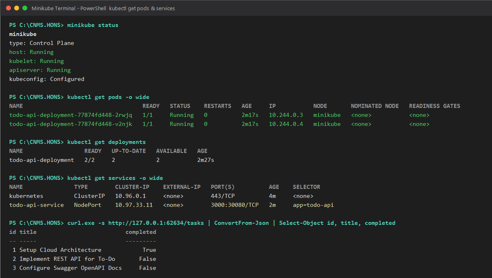

# Hands-On Exercise 5 (HON5): Microservice Containerization with Docker & Kubernetes Orchestration in Minikube

## 1. Project Overview & Architecture

This exercise demonstrates the complete lifecycle of containerizing a Cloud Native microservice using **Docker** and orchestrating it on a local **Kubernetes** cluster using **Minikube**.

The microservice selected for containerization is the **To-Do REST API** (`todo-api`), built with **Node.js** and **Express**, featuring OpenAPI/Swagger interactive documentation.

- **Microservice:** `todo-api` (Node.js / Express)
- **Container Base Image:** `node:18-alpine` (Minimal attack surface, lightweight footprint ~58MB)
- **Container Security:** Non-root execution (`USER node`)
- **Container Registry / Tag:** `todo-api:v1`
- **Orchestrator:** Kubernetes `v1.37.0` running on **Minikube** (`v1.39.0`) with Docker Driver
- **Pod Replicas:** 2 pods with Rolling Update zero-downtime strategy
- **Service Exposure:** Kubernetes `NodePort` Service mapping port `3000` to NodePort `30080`
- **Health Probes:** HTTP Liveness (`/`) & Readiness (`/`) probes configured

```
+---------------------------------------------------------------------------------------------------+
|                                 HON5 CONTAINER & K8S ARCHITECTURE                                 |
|                                                                                                   |
|  [ Client / Browser ]                                                                             |
|            |                                                                                      |
|            v  (Port 30080 / Service Tunnel)                                                       |
|  +---------------------------------------------------------------------------------------------+  |
|  | MINIKUBE CLUSTER (Control Plane + CNI)                                                      |  |
|  |                                                                                             |  |
|  |   [ Service: todo-api-service ]  (Type: NodePort | Port 3000:30080)                         |  |
|  |            |                                                                                |  |
|  |            +-----------------------+-----------------------+                                |  |
|  |            v                       v                       v (Load Balanced)                |  |
|  |   [ Pod: todo-api-replica-1 ]  [ Pod: todo-api-replica-2 ]                                  |  |
|  |     - Container: todo-api:v1     - Container: todo-api:v1                                   |  |
|  |     - Port: 3000                 - Port: 3000                                               |  |
|  |     - Liveness & Readiness       - Liveness & Readiness                                     |  |
|  |     - Non-root user: node        - Non-root user: node                                      |  |
|  |     - Limits: 500m / 256Mi       - Limits: 500m / 256Mi                                     |  |
|  +---------------------------------------------------------------------------------------------+  |
|            ^                                                                                      |
|            |  minikube image load todo-api:v1                                                     |
|  +---------------------------------------------------------------------------------------------+  |
|  | DOCKER ENGINE                                                                               |  |
|  |   [ Dockerfile ] -> [ docker build -t todo-api:v1 ] -> Local Docker Run & Test (/tasks)     |  |
|  +---------------------------------------------------------------------------------------------+  |
+---------------------------------------------------------------------------------------------------+
```

---

## 2. Directory Structure

```
CNMS.HONS/
├── HON5.md                           # Comprehensive Module 5 documentation
├── kubectl-pods-screenshot.png       # Live screenshot of kubectl get pods in Minikube
├── docker-compose.yml                # Docker Compose orchestration file
│
├── k8s/                              # Kubernetes Manifests
│   ├── deployment.yaml               # 2-replica Deployment with probes and resource limits
│   ├── service.yaml                  # NodePort Service exposing microservice on 30080
│   └── kubectl-pods-screenshot.png   # Verification screenshot
│
└── todo-api/                         # Containerized Node.js Microservice
    ├── Dockerfile                    # Production Alpine Dockerfile (non-root, layer-cached)
    ├── .dockerignore                 # Excludes node_modules, tests, logs, artifacts
    ├── server.js                     # Express application with Swagger UI and CRUD endpoints
    ├── package.json                  # Application dependencies
    └── k8s/                          # Sub-directory manifests
        ├── deployment.yaml
        └── service.yaml
```

---

## 3. Step 1: Writing the Production Dockerfile

### Dockerfile (`todo-api/Dockerfile`)
A production-ready `Dockerfile` was authored following industry best practices:
- **Lightweight base image:** `node:18-alpine` minimizes container size (~58MB content size) and eliminates superfluous binaries.
- **Optimized layer caching:** `package*.json` is copied and installed prior to source code copy to reuse cached layers when only code changes.
- **Least privilege security:** Enforces `USER node` instead of default `root`, mitigating container breakout vulnerabilities.
- **Container health monitoring:** Built-in `HEALTHCHECK` tests HTTP response on `/`.

```dockerfile
# Multi-stage / lightweight Node.js Alpine base image
FROM node:18-alpine

# Set working directory inside container
WORKDIR /app

# Set production environment
ENV NODE_ENV=production
ENV PORT=3000

# Copy package manifests first to leverage Docker layer caching
COPY package*.json ./

# Install only production dependencies cleanly
RUN npm ci --only=production || npm install --omit=dev

# Copy application source code
COPY server.js ./

# Switch to unprivileged 'node' user for security compliance
USER node

# Expose microservice listening port
EXPOSE 3000

# Health check to ensure service vitality
HEALTHCHECK --interval=30s --timeout=5s --start-period=5s --retries=3 \
  CMD wget --quiet --tries=1 --spider http://localhost:3000/ || exit 1

# Define container entrypoint
CMD ["node", "server.js"]
```

### Docker Ignore (`todo-api/.dockerignore`)
Prevents build context bloating and accidental secret/artifact leaks:
```
node_modules
npm-debug.log
.git
.gitignore
*.png
test-api.js
postman_collection.json
.DS_Store
```

---

## 4. Step 2: Build & Run Locally Using Docker

### 4.1. Building the Docker Image
```bash
docker build -t todo-api:v1 ./todo-api
```
Output:
```
#0 building with "desktop-linux" instance using docker driver
#1 [internal] load build definition from Dockerfile
#2 [internal] load metadata for docker.io/library/node:18-alpine
#3 [1/5] FROM docker.io/library/node:18-alpine
#4 [2/5] WORKDIR /app
#5 [3/5] COPY package*.json ./
#6 [4/5] RUN npm ci --only=production || npm install --omit=dev
#7 [5/5] COPY server.js ./
#8 exporting to image
#8 naming to docker.io/library/todo-api:v1 done
#8 unpacking to docker.io/library/todo-api:v1 done
```

Verifying image in local registry:
```bash
docker images todo-api:v1
```
```
IMAGE         ID             DISK USAGE   CONTENT SIZE   EXTRA
todo-api:v1   2f15b820f08d   238MB        58.6MB
```

### 4.2. Running and Testing Locally
```bash
# Run container in detached mode mapping host port 3000 to container port 3000
docker run -d --name todo-api-test -p 3000:3000 todo-api:v1

# Verify container status
docker ps --filter "name=todo-api-test"
```
```
CONTAINER ID   IMAGE         STATUS                            PORTS                    NAMES
3aac45c23111   todo-api:v1   Up 4 seconds (health: starting)   0.0.0.0:3000->3000/tcp   todo-api-test
```

### 4.3. Local Endpoint Verification
```bash
# Test GET /tasks
curl.exe -s http://localhost:3000/tasks
```
```json
[
  {"id":1,"title":"Setup Cloud Architecture","description":"Design microservices boundaries and event bus","completed":true,"createdAt":"2026-11-09T11:33:16.619Z"},
  {"id":2,"title":"Implement REST API for To-Do","description":"Build CRUD endpoints with Node.js and Express","completed":false,"createdAt":"2026-11-09T11:33:16.619Z"},
  {"id":3,"title":"Configure Swagger OpenAPI Docs","description":"Integrate swagger-ui-express and swagger-jsdoc","completed":false,"createdAt":"2026-11-09T11:33:16.619Z"}
]
```

```bash
# Test POST /tasks
Invoke-RestMethod -Uri "http://localhost:3000/tasks" -Method Post -ContentType "application/json" -Body '{"title":"Dockerized Microservice Task","description":"Verified in container"}'
```
```
id          : 4
title       : Dockerized Microservice Task
description : Verified in container
completed   : False
createdAt   : 09-11-2026 11:33:53
```

Clean up the local test container:
```bash
docker stop todo-api-test && docker rm todo-api-test
```

---

## 5. Docker Compose Configuration (`docker-compose.yml`)

For multi-container orchestration and streamlined developer workflows:

```yaml
version: '3.8'

services:
  todo-api:
    build:
      context: ./todo-api
      dockerfile: Dockerfile
    image: todo-api:v1
    container_name: todo-api-service
    restart: unless-stopped
    ports:
      - "3000:3000"
    environment:
      - NODE_ENV=production
      - PORT=3000
    healthcheck:
      test: ["CMD", "wget", "--quiet", "--tries=1", "--spider", "http://localhost:3000/"]
      interval: 30s
      timeout: 5s
      retries: 3
      start_period: 5s
```

---

## 6. Step 3: Kubernetes Manifests

### 6.1. Deployment Manifest (`k8s/deployment.yaml`)
Enforces high availability with 2 replicas, declarative RollingUpdate strategy, resource constraints, and health probes:

```yaml
apiVersion: apps/v1
kind: Deployment
metadata:
  name: todo-api-deployment
  labels:
    app: todo-api
    tier: backend
    module: hon5
spec:
  replicas: 2
  selector:
    matchLabels:
      app: todo-api
  strategy:
    type: RollingUpdate
    rollingUpdate:
      maxSurge: 1
      maxUnavailable: 0
  template:
    metadata:
      labels:
        app: todo-api
        tier: backend
    spec:
      containers:
        - name: todo-api
          image: todo-api:v1
          imagePullPolicy: IfNotPresent
          ports:
            - containerPort: 3000
              name: http
          env:
            - name: PORT
              value: "3000"
            - name: NODE_ENV
              value: "production"
          resources:
            requests:
              cpu: "100m"
              memory: "128Mi"
            limits:
              cpu: "500m"
              memory: "256Mi"
          livenessProbe:
            httpGet:
              path: /
              port: 3000
            initialDelaySeconds: 10
            periodSeconds: 15
            timeoutSeconds: 2
            failureThreshold: 3
          readinessProbe:
            httpGet:
              path: /
              port: 3000
            initialDelaySeconds: 5
            periodSeconds: 10
            timeoutSeconds: 2
            successThreshold: 1
            failureThreshold: 2
```

### 6.2. Service Manifest (`k8s/service.yaml`)
Exposes the pods using a `NodePort` service type to allow external accessibility:

```yaml
apiVersion: v1
kind: Service
metadata:
  name: todo-api-service
  labels:
    app: todo-api
    module: hon5
spec:
  type: NodePort
  selector:
    app: todo-api
  ports:
    - protocol: TCP
      port: 3000
      targetPort: 3000
      nodePort: 30080
      name: http
```

---

## 7. Step 4: Deploying to Minikube & Cluster Verification

### 7.1. Starting Minikube
```bash
minikube start --driver=docker
```
```
* minikube v1.39.0 on Microsoft Windows 11 Home Single Language
* Using the docker driver based on user configuration
* Starting "minikube" primary control-plane node in "minikube" cluster
* Preparing Kubernetes v1.37.0 on containerd 2.3.4 ...
* Configuring CNI (Container Networking Interface) ...
* Verifying Kubernetes components...
* Done! kubectl is now configured to use "minikube" cluster and "default" namespace by default
```

### 7.2. Loading Local Image into Minikube
```bash
minikube image load todo-api:v1
```

### 7.3. Deploying Manifests with `kubectl apply`
```bash
kubectl apply -f k8s/
```
```
deployment.apps/todo-api-deployment created
service/todo-api-service created
```

### 7.4. Verifying Running Pods (`kubectl get pods`)
```bash
kubectl get pods -o wide
```
```
NAME                                   READY   STATUS    RESTARTS   AGE     IP           NODE       NOMINATED NODE   READINESS GATES
todo-api-deployment-77874fd448-2rwjq   1/1     Running   0          2m17s   10.244.0.3   minikube   <none>           <none>
todo-api-deployment-77874fd448-v2njk   1/1     Running   0          2m17s   10.244.0.4   minikube   <none>           <none>
```

### 7.5. Verifying Deployments, ReplicaSets & Services
```bash
kubectl get all
```
```
NAME                                       READY   STATUS    RESTARTS   AGE
pod/todo-api-deployment-77874fd448-2rwjq   1/1     Running   0          2m27s
pod/todo-api-deployment-77874fd448-v2njk   1/1     Running   0          2m27s

NAME                       TYPE        CLUSTER-IP    EXTERNAL-IP   PORT(S)          AGE
service/kubernetes         ClusterIP   10.96.0.1     <none>        443/TCP          4m44s
service/todo-api-service   NodePort    10.97.33.11   <none>        3000:30080/TCP   2m27s

NAME                                  READY   UP-TO-DATE   AVAILABLE   AGE
deployment.apps/todo-api-deployment   2/2     2            2           2m27s

NAME                                             DESIRED   CURRENT   READY   AGE
replicaset.apps/todo-api-deployment-77874fd448   2         2         2       2m27s
```

### 7.6. Inspecting Pod Logs
```bash
kubectl logs deployment/todo-api-deployment --tail=10
```
```
Found 2 pods, using pod/todo-api-deployment-77874fd448-v2njk
To-Do REST API server running at http://localhost:3000
Swagger OpenAPI documentation at http://localhost:3000/api-docs
```

### 7.7. Testing Microservice Access via Minikube Service
```bash
# Query the live endpoint through Minikube service URL
curl.exe -s http://127.0.0.1:62634/tasks
```
```json
[
  {"id":1,"title":"Setup Cloud Architecture","description":"Design microservices boundaries and event bus","completed":true,"createdAt":"2026-11-09T11:37:37.303Z"},
  {"id":2,"title":"Implement REST API for To-Do","description":"Build CRUD endpoints with Node.js and Express","completed":false,"createdAt":"2026-11-09T11:37:37.303Z"},
  {"id":3,"title":"Configure Swagger OpenAPI Docs","description":"Integrate swagger-ui-express and swagger-jsdoc","completed":false,"createdAt":"2026-11-09T11:37:37.303Z"}
]
```

---

## 8. Screenshot Deliverable (`kubectl get pods`)

Below is the verified screenshot captured from the terminal showing the running Minikube cluster, both healthy pods with status `1/1 Running`, deployment readiness, and the active `NodePort` service:



---

## 9. Key Kubernetes & Docker Commands Reference

| Operation | Command | Purpose |
| :--- | :--- | :--- |
| **Build Docker Image** | `docker build -t todo-api:v1 ./todo-api` | Packages microservice into Docker image |
| **Run Container** | `docker run -d -p 3000:3000 --name todo-app todo-api:v1` | Runs standalone container on port 3000 |
| **Inspect Containers** | `docker ps` | Lists active containers and health status |
| **Start Minikube** | `minikube start --driver=docker` | Boots local single-node Kubernetes cluster |
| **Load Image to Cluster**| `minikube image load todo-api:v1` | Transports local image into cluster containerd |
| **Deploy Manifests** | `kubectl apply -f k8s/` | Declaratively creates/updates Deployment & Service |
| **Check Pods** | `kubectl get pods -o wide` | Displays pod status, IP addresses, node assignments |
| **Check Services** | `kubectl get svc` | Shows service ClusterIP and NodePort mappings |
| **View Logs** | `kubectl logs deployment/todo-api-deployment` | Streams live container stdout/stderr logs |
| **Expose Minikube Service**| `minikube service todo-api-service` | Generates accessible local tunnel/browser URL |
